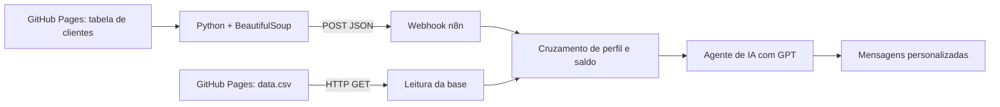

Assistente de Investimentos com RPA, n8n e IA Generativa
Projeto desenvolvido como parte do desafio "Criando um Assistente de Investimentos com RPA e IA Generativa", da DIO (Digital Innovation One).

A proposta é demonstrar, com dados fictícios, como automatizar a coleta de informações de clientes, consultar uma base de produtos financeiros e gerar mensagens personalizadas usando Python, n8n e GPT.
Aviso: este é um projeto educacional. As opções de investimento e as mensagens produzidas são simulações, não recomendações financeiras.

Objetivo
Construir um fluxo de automação capaz de:
1. Extrair de uma página HTML o nome, e-mail, saldo e perfil de investidores fictícios.
2. Enviar os dados extraídos para o n8n por meio de um Webhook HTTP POST.
3. Consultar o arquivo docs/data.csv, com opções de investimentos por perfil.
4. Cruzar perfil do investidor, saldo disponível e investimento mínimo.
5. Gerar uma mensagem personalizada para cada cliente usando IA generativa (GPT).
Arquitetura da solução

Tecnologias utilizadas
Tecnologia	Aplicação no projeto
Python	Extração e envio dos dados
Requests + BeautifulSoup	Leitura da página HTML e da tabela de clientes
Google Colab	Execução do notebook de RPA
n8n Cloud	Orquestração da automação
Webhook	Recebimento dos clientes em JSON
HTTP Request	Consulta à base CSV de investimentos
Code (JavaScript)	Validação e cruzamento das informações
Agente de IA + GPT	Geração de mensagens personalizadas
GitHub / GitHub Pages	Versionamento e disponibilização dos dados do exercício

Como o fluxo funciona
1. Extração dos clientes (RPA)
O notebook Python acessa a página disponibilizada pela DIO e identifica as linhas da tabela HTML usando BeautifulSoup. Para cada cliente, extrai os campos nome, email, saldo e perfil.
2. Envio ao n8n
O Python envia os registros em formato JSON para o Webhook do n8n:
{
  "clientes": [
    {
      "nome": "Ana Silva",
      "email": "ana@email.com",
      "saldo": "R$ 12.500,00",
      "perfil": "Conservador"
    }
  ]
}
O exemplo acima utiliza dados fictícios.
3. Consulta à base de investimentos
Um nó HTTP Request busca o arquivo data.csv publicado no GitHub Pages. A base contém produtos associados aos perfis Conservador, Moderado e Arrojado.
4. Cruzamento de informações
Um nó Code interpreta os dados, converte o saldo para valor numérico e seleciona apenas as opções compatíveis com o perfil e com o investimento mínimo de cada produto.

Essa regra é executada antes da etapa de IA: o modelo de linguagem recebe as opções já filtradas, em vez de decidir sozinho quais produtos são elegíveis.
5. Mensagens com IA generativa
O agente de IA utiliza GPT para redigir uma mensagem específica para cada cliente, considerando o nome, o saldo, o perfil e as opções compatíveis encontradas na base.

O agente foi orientado a não inventar produtos, não prometer rentabilidade e incluir o aviso de que o conteúdo é uma simulação educacional.
6. Resultado
O fluxo organiza, para cada cliente, os dados de identificação e a mensagem gerada. Os resultados podem ser consultados na aba Executions do n8n, no nó final do workflow.

Nesta implementação, as mensagens são geradas e exibidas no n8n; não são enviadas automaticamente por e-mail ou WhatsApp.
Versões desenvolvidas
- MVP — mensagens estáticas: utiliza textos definidos para cada perfil de investidor e apresenta as opções compatíveis da base.
- Versão com IA generativa: utiliza um agente conectado ao GPT para criar mensagens dinâmicas e personalizadas.
A versão com IA foi publicada no n8n Cloud e, conforme os testes realizados durante o desenvolvimento, executou a consulta ao CSV e a geração das mensagens pelo GPT. O envio a partir do notebook Python deve ser demonstrado pelas evidências da entrega.
Como executar
1. Abra o notebook Python do projeto no Google Colab.
2. Execute as células de instalação das bibliotecas e extração dos clientes.
3. No n8n, importe o arquivo n8n/workflow.json da versão com IA e configure as credenciais/modelo de linguagem necessários à sua instância.
4. Publique o workflow e copie a URL de produção do nó Webhook.
5. No notebook, substitua a URL de exemplo pela URL do seu Webhook e execute a célula que envia os clientes via POST.
6. Abra Executions no n8n e confira a execução, a leitura da base e as mensagens no nó final.
Para testes sem publicação, use a URL webhook-test enquanto o nó Webhook estiver em Listen for test event. Para o workflow publicado, use a URL webhook de produção.

Evidências de execução
Os registros visuais do exercício devem mostrar:
- O notebook no Colab extraindo e enviando os clientes.
- A execução do workflow no n8n, com os nós concluídos.
- A saída final com as mensagens geradas pelo GPT.
Para adicionar as capturas ao README: envie as imagens para uma pasta prints/ no repositório e, depois, substitua esta seção por links Markdown, por exemplo: .

Estrutura do repositório
dio-lab-assistente-investimentos-rpa-n8n/
├── README.md
├── docs/
│   ├── index.html
│   └── data.csv
├── rpa/
│   └── extrair_clientes.ipynb
└── n8n/
    └── workflow.json
A pasta n8n/ e o arquivo workflow.json devem ser adicionados ao fork após a exportação do fluxo. O notebook fica na pasta rpa/ do repositório original consultado.

Aprendizados e decisões técnicas
- Uso de web scraping para integrar uma página sem API específica.
- Comunicação entre Python e n8n por meio de um Webhook.
- Tratamento de dados em formatos diferentes, como moeda brasileira e CSV.
- Separação entre regras determinísticas (filtro de produtos) e geração de linguagem natural (GPT).
- Importância de validar os resultados e registrar evidências de execução.
Possíveis melhorias
- Registrar o histórico das mensagens em planilha ou banco de dados.
- Criar um painel para acompanhar as execuções.
- Adicionar envio de mensagens mediante autorização e validação dos destinatários.
- Melhorar o tratamento de falhas e a observabilidade do fluxo.
Créditos
Projeto realizado a partir do desafio e dos materiais disponibilizados pela DIO — Digital Innovation One, com implementação e documentação próprias para fins de aprendizado e portfólio.
